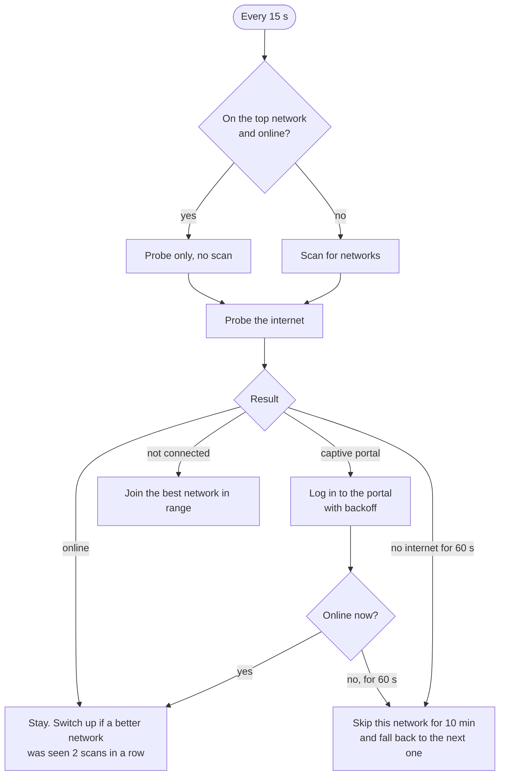

<div align="center">


# SmartWiFi

**Keeps an always-on Windows laptop online.**
Uses your phone hotspot whenever the phone is nearby, falls back to the hostel Wi-Fi when it isn't,
and logs in to the hostel's captive portal by itself, so remote access never drops.

[](https://github.com/sehrawaty/SmartWiFi/actions/workflows/build.yml)
[](https://github.com/sehrawaty/SmartWiFi/releases)


[](LICENSE)

[Install](#install) · [How it works](#how-it-works) · [Captive portals](#captive-portals) · [Settings](#settings) · [FAQ](#faq)

</div>

---

## The problem

The laptop stays on in a hostel room, running a few projects and reachable from a phone over Tailscale or a remote-desktop tool.
When it's on the phone's hotspot and the phone leaves the room, the laptop loses internet, and every remote session drops
until someone walks back and switches networks by hand. Windows won't fix this on its own: it happily sits on a network with
no internet, and the hostel Wi-Fi wants a browser login before it lets anything through.

## The fix

SmartWiFi is a small tray app. Every 15 seconds it checks which networks are in range and whether the current one actually
reaches the internet. When the hotspot disappears it joins the hostel Wi-Fi, fills in the portal login, and gets the laptop
back online in seconds. When the phone comes back, it switches back to the faster hotspot.

| | |
|---|---|
| 🔀 **Automatic switching** | A priority list of networks with fallbacks. Switches up when a better network is seen in two scans in a row; falls back the moment the current one is gone. |
| 🔐 **Captive portal login** | Presets for FortiGate and Pronto Networks portals, plus a custom form for anything else. Retries on a backoff: 15 s, 30 s, 60 s, then every 2 min. |
| 📱 **Phone notifications** | Push messages through [ntfy](https://ntfy.sh) when the network changes, the portal login keeps failing, the laptop comes back online, or the data cap is hit. Queued while offline and delivered later with the real time. |
| 📊 **Hotspot data meter** | Counts megabytes used on the hotspot each day. An optional daily cap moves the laptop to the hostel Wi-Fi until midnight; "Allow 500 MB more" from the tray. |
| 🛡️ **Tailscale aware** | Optionally turns Tailscale off on the hotspot and back on afterwards, but only if SmartWiFi was the one that turned it off. |
| ☕ **Keep awake + watchdog** | Stops idle sleep while plugged in. If nothing has had internet for 5 minutes, it reconnects Wi-Fi to unstick the adapter. |
| 🪶 **Small on purpose** | One tray icon, one settings window, no admin rights, no service, no background installer. Passwords encrypted with Windows DPAPI. |

## How it works



**Network priority** (you set the order in Settings):

| Role | Network | Rule |
|---|---|---|
| **Preferred** | Phone hotspot | Joined as soon as it's seen in two scans in a row |
| Fallback 1 | Hostel Wi-Fi | Used when the hotspot is gone; captive portal handled |
| Fallback 2+ | Anything you add | Tried in the order you set |

A few rules keep it from flapping:

- A network that has had **no internet for a minute** is skipped for ten, as long as there is something else to try.
- A network you **pick from the tray menu** is kept for ten minutes while it keeps working.
- A network you joined **yourself in Windows** that isn't in SmartWiFi's list is left alone while it has internet.
- When it's already **online on the top network** it doesn't scan at all, so there are no latency blips during calls or SSH sessions.

The internet check is the same one Windows uses (NCSI): fetch `http://www.msftconnecttest.com/connecttest.txt` and compare the reply.
A redirect or a different page means a portal is in the way, and its address is passed to the portal login.

### What a switch looks like

From the activity log (tray → *Activity log…*, dates trimmed), the phone walking out of the room and coming back:

```text
14:02:11 [INFO ] network: Pixel Hotspot → none
14:02:11 [INFO ] not connected, switching to Hostel-WiFi
14:02:13 [OK   ] joined Hostel-WiFi
14:02:16 [INFO ] on Hostel-WiFi without internet, logging in to the portal
14:02:18 [OK   ] portal: logged in, online
...
14:41:30 [INFO ] Pixel Hotspot is back in range, switching to Pixel Hotspot
14:41:32 [OK   ] joined Pixel Hotspot
```

## Install

**One line** (PowerShell, no admin):

```powershell
irm https://raw.githubusercontent.com/sehrawaty/SmartWiFi/main/scripts/install.ps1 | iex
```

This downloads `SmartWiFi.exe` from the [latest release](https://github.com/sehrawaty/SmartWiFi/releases/latest) into
`%LOCALAPPDATA%\Programs\SmartWiFi`, adds a Start menu shortcut and starts it. SmartWiFi then starts itself when you sign in
(turn that off in Settings → General).

**Or by hand:** download `SmartWiFi.exe` from [Releases](https://github.com/sehrawaty/SmartWiFi/releases), put it anywhere, and run it.
It's a single self-contained file, so .NET doesn't need to be installed.

> [!NOTE]
> The exe isn't code-signed, so the first run may show *"Windows protected your PC"*. Click **More info → Run anyway**.
> You can check the file against the `.sha256` published next to it, or build it yourself (below).

**Uninstall:** `scripts\uninstall.ps1` (add `-RemoveSettings` to delete settings and logs too).

### Requirements

- Windows 10 (2004 or later) or Windows 11, x64
- A Wi-Fi adapter (the WLAN AutoConfig service must be running, which it is by default)

## Getting started

The first time it runs, the Settings window opens.

1. **Networks → Add…** your phone hotspot. Pick it from the list, type its password, and tick *This is my phone hotspot*.
   It goes to the top of the list.
2. **Add…** the hostel Wi-Fi. If it has a login page, tick *Log in to a captive portal*, choose the portal type,
   and enter your portal username and password (see [Captive portals](#captive-portals)).
3. Optional: **Notifications** → turn on ntfy, press *Random* for a topic, and subscribe to the same topic in the
   [ntfy app](https://ntfy.sh) on your phone. Press *Send a test notification*.
4. **Save.** Turn the hotspot off and watch the tray icon go amber, then green on the hostel Wi-Fi.

Passwords are optional for networks Windows already knows; SmartWiFi will use the saved Windows profile.

### The tray icon

| Icon | Meaning |
|---|---|
| 🟢 green | Online |
| 🟠 amber | Captive portal login needed, or checking after a switch |
| 🔴 red | Connected but no internet |
| ⚪ grey | Not connected (grey arcs with a coloured dot = auto-switching paused) |

A hollow dot means you're on the hotspot. Click the icon for the menu: current network and signal, today's hotspot data,
**Switch to ▸**, **Log in to portal now**, **Tailscale** on/off, **Pause auto-switching ▸**, **Check now**, Settings and the activity log.

## Captive portals

Portal logins are plain HTTP form posts, described as data so new portals don't need code:

| Preset | For | What it sends |
|---|---|---|
| **FortiGate** | Fortinet portals, the `…:1000/fgtauth?…` pages common on campuses | `4Tredir`, `magic` (taken from the redirect), `username`, `password` to the portal host |
| **Pronto Networks** | `phc.prontonetworks.com` hostel portals | `userId`, `password`, `serviceName=ProntoAuthentication`, `Submit22=Login` |
| **Custom form** | Anything else | Whatever URL, method and fields you give it |

Field values can use placeholders: `{username}`, `{password}`, `{magic}`, `{redirect}`, `{portalUrl}`, `{portalBase}`.

> [!TIP]
> Not sure what your portal expects? Open its login page in a browser, press **F12 → Network**, log in, and click the request
> that was sent. Copy its URL into *Login URL* and each form field into the table. [docs/portals.md](docs/portals.md) walks
> through it step by step.

Presets are a starting point: portals get reconfigured, so if login keeps failing, check the activity log, then compare the
fields against what your browser sends.

## Settings

Everything is in one window with four tabs. Defaults in brackets.

**General**

| Setting | What it does |
|---|---|
| Start with Windows [on] | Adds SmartWiFi to your user's startup (`HKCU\…\Run`). |
| Keep awake while plugged in [on] | Stops idle sleep on AC power. The screen can still turn off. |
| Watchdog [on, 5 min] | Reconnects Wi-Fi when nothing has had internet for this long, at most every 10 minutes. |
| Daily hotspot cap [0 = off] | MB per day on networks marked as hotspot. Resets at midnight. |
| Check every [15 s] | How often to scan and probe. |
| Switch up after [2 scans] | How many scans in a row a better network must be seen before switching to it. |
| Skip after [60 s] / for [10 min] | How long a network can be offline before it's benched, and for how long. |
| Keep a menu pick for [10 min] | How long a manual choice from the tray holds. |
| Probe URL / expected reply | The internet check. Must be plain `http://`. |

**Notifications:** ntfy server [`https://ntfy.sh`], topic, optional access token, which events to send, and whether to also show Windows notifications.

**Tailscale:** turn it off on the hotspot [off], path to `tailscale.exe` [auto-detected], and the command used to reconnect [`up`].
If you normally run `tailscale up` with flags, put the same flags there.

## Files and privacy

| What | Where |
|---|---|
| Settings | `%APPDATA%\SmartWiFi\settings.json` |
| Logs (kept 14 days) | `%LOCALAPPDATA%\SmartWiFi\logs\` |
| Hotspot data usage | `%LOCALAPPDATA%\SmartWiFi\usage.json` |
| Undelivered notifications | `%LOCALAPPDATA%\SmartWiFi\notification-queue.json` |

Wi-Fi, portal and ntfy passwords are encrypted with [DPAPI](https://learn.microsoft.com/windows/win32/api/dpapi/) for your
Windows account; `settings.json` only ever holds the encrypted blob. SmartWiFi talks to three places: the Microsoft connectivity
check URL, your portal, and your ntfy server if you turn notifications on. No analytics, no telemetry.

## FAQ

<details>
<summary><b>Does it need administrator rights?</b></summary>

No. Scanning, joining networks, creating Wi-Fi profiles and the startup entry all work as a normal user.
</details>

<details>
<summary><b>The laptop still goes to sleep.</b></summary>

*Keep awake* only blocks idle sleep while plugged in. Closing the lid follows its own setting: Control Panel → Power Options →
*Choose what closing the lid does* → **Do nothing** for *Plugged in*. Also check that the Wi-Fi adapter isn't allowed to power down
(Device Manager → your Wi-Fi adapter → Power Management).
</details>

<details>
<summary><b>Windows opens a browser asking me to sign in to the network.</b></summary>

That's Windows' own portal detection. SmartWiFi logs in within a few seconds anyway; you can close the browser tab.
Unlike macOS, Windows doesn't cut other apps off while that window is open.
</details>

<details>
<summary><b>The hotspot isn't switched back to.</b></summary>

Check that it's above the hostel Wi-Fi in the list, and that the phone is actually broadcasting (some phones turn the hotspot
off after a few idle minutes; look for "turn off hotspot automatically" in the phone's settings). The activity log shows each
decision.
</details>

<details>
<summary><b>Portal login keeps failing.</b></summary>

Open the activity log: the line after *logging in to the portal* shows the HTTP status. Make sure the username and password work
in a browser, then compare the form fields with what the browser sends (F12 → Network). If the portal uses a self-signed
certificate, tick *Accept the portal's self-signed certificate*.
</details>

<details>
<summary><b>Is it safe to leave a laptop on all the time?</b></summary>

Generally yes. The thing that wears out is the battery: sitting at 100% while warm ages it faster. If your laptop has a charge
limit (Lenovo Vantage *Conservation mode*, ASUS *Battery Health Charging*, Dell Power Manager, HP battery care), set it to 80% or
lower. Keep it on a hard surface so the vents can breathe, restart it about once a week, and unplug it if the battery ever looks
swollen.
</details>

<details>
<summary><b>Enterprise networks (eduroam, 802.1X)?</b></summary>

SmartWiFi can switch to them but can't create their profile. Connect once from Windows Settings, then add the network in
SmartWiFi without a password.
</details>

## Building from source

You need the [.NET 8 SDK](https://dotnet.microsoft.com/download/dotnet/8.0).

```powershell
git clone https://github.com/sehrawaty/SmartWiFi.git
cd SmartWiFi
dotnet test                                        # 50 tests for the switching engine, portal login, probe, data meter, notifier
dotnet publish src/SmartWiFi -c Release -o publish # → publish\SmartWiFi.exe
.\scripts\install.ps1 -Source .\publish\SmartWiFi.exe
```

The core library has no Windows dependencies, so `dotnet test` runs on Linux and macOS too. Every push builds the exe on
GitHub Actions; pushing a `v*` tag publishes a release.

```text
src/
  SmartWiFi.Core/        Platform-neutral logic: the switching engine, connectivity probe,
                         portal login, data meter, ntfy notifier, settings and logging
  SmartWiFi/             The Windows app: tray icon and menu, settings window,
                         Native Wi-Fi adapter (wlanapi), DPAPI, keep-awake, autostart, Tailscale CLI
tests/
  SmartWiFi.Core.Tests/  The engine driven by fake Wi-Fi, clock and portal
scripts/                 install.ps1, uninstall.ps1
```

## Roadmap

- [ ] Answer from the phone: ntfy action buttons to switch networks or pause remotely
- [ ] Per-network schedules (e.g. never use the hotspot at night)
- [ ] Mark the hotspot as a metered connection in Windows automatically
- [ ] Signed releases and a winget package
- [ ] ARM64 build

## Acknowledgements

The idea and the behaviour (two-scan switch-up, skip-after-a-minute, portal backoff, queued phone notifications) follow a
macOS menu bar app of the same name. Wi-Fi access uses [ManagedNativeWifi](https://github.com/emoacht/ManagedNativeWifi);
phone notifications use [ntfy](https://ntfy.sh).

## License

[MIT](LICENSE)
